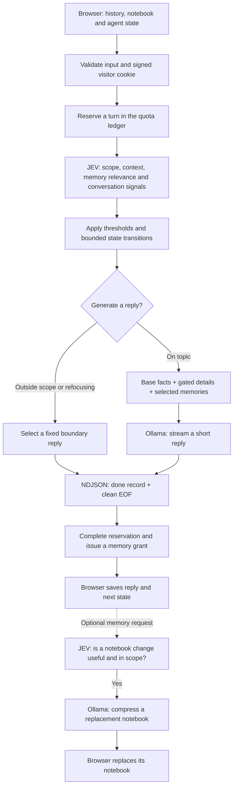

# Architecture

[← Overview](../README.md) · [Architecture](architecture.md) · [Setup](setup.md) · [API](api.md) · [Operations](operations.md)

## Design goal

Build a small, cost-conscious Cloudflare-powered agent with explicit usage guardrails. The portfolio persona is the included use case; the core design is a bounded inference pipeline with a decision layer, selective context and durable usage accounting.

Cost control happens at several points:

- **Before inference:** reserve a visitor turn, reject duplicates and enforce weekly and rolling-minute limits.
- **Before generation:** use JEV to evaluate scope and context needs; select a fixed reply when generation is unnecessary or disallowed.
- **Inside the reply prompt:** include base facts, gated detail sections and relevant active notebook entries; cap generated replies at 120 tokens.
- **During memory updates:** require a completed-turn grant and a useful, in-scope change before notebook compression.

Cloudflare Workers runs the orchestration, Workers AI runs JEV, and a SQLite Durable Object stores quota records. Ollama supplies reply generation and memory compression. The browser stores conversation history and the notebook.

Per-visitor quotas bound usage for a signed browser identity, not total deployment spending. Cookie resets can create new identities; provider spending limits and stronger edge controls remain deployment considerations. JEV itself adds inference work, so measure the full pipeline against your traffic before claiming cost savings.

## Request flow

The request flow is plain TypeScript orchestration. Each chat makes one JEV decision call before optional reply generation. Notebook updates are separate, client-initiated requests with their own decision gate.

## Why JEV?

JEV acts as the decision layer. It returns structured choices and probability scores that the application validates before deciding which work to perform.

| Decision                 | What Mo does with it                                                                           | Intended benefit                                             |
| ------------------------ | ---------------------------------------------------------------------------------------------- | ------------------------------------------------------------ |
| **Scope**                | Generates only for an `on_topic` choice with confidence ≥ 0.7; otherwise selects a fixed reply | Avoids an Ollama call for rejected or uncertain requests     |
| **Detailed context**     | Adds bundled detail sections when the score is ≥ 0.7; keywords select the sections             | Keeps simple turns from carrying the full knowledge snapshot |
| **Memory relevance**     | Includes active notebook entries with relevance > 0.45                                         | Keeps the reply prompt focused on useful visitor context     |
| **Conversation signals** | Feeds abuse, topic hopping, calming and focus scores into bounded state transitions            | Adjusts firmness while allowing recovery and cooldown        |
| **Notebook updates**     | Requires an on-topic request and update score ≥ 0.5 before compression                         | Avoids rewriting memory for turns that add nothing useful    |

These gates aim to reduce unnecessary generation, prompt context and notebook compression. They are architectural choices, not measured cost or latency guarantees: JEV adds its own inference call, and the result depends on your models and traffic.

Scope, memory and behavior decisions remain separate. A malformed optional answer cannot erase a valid scope decision. Uncertain scope prevents reply generation; a JEV chat failure produces a fixed clarification and refunds the reservation. The fixed persona and application rules stay server-defined.

## Memory and conversational behavior

The browser supplies recent history and a compact notebook on each request. JEV selects relevant entries, allowing Mo to use a voluntarily offered name or recognize a returning visitor from supplied context. A useful notebook change is compressed into a replacement document with an expiry, then returned to the browser for storage.

Mo's frustration state is also returned to the client. It stays within 0–3, cools over time and can recover through a focused question or calm acknowledgment. At the refocusing threshold, Mo uses a fixed boundary reply instead of calling Ollama. This state shapes conversational behavior; signed cookies and durable quotas handle operational access separately.

## Stack at a glance

| Layer                | Implementation                                                      |
| -------------------- | ------------------------------------------------------------------- |
| Runtime              | Cloudflare Workers, Bun tooling and TypeScript                      |
| Decisions            | Workers AI / `typesafe/jev` through AI Gateway                      |
| Generation           | Ollama chat API with streamed NDJSON and a 120-token reply budget   |
| Knowledge            | Bundled base facts and keyword-selected detail sections             |
| Conversation storage | Frontend-owned history, notebook and agent state                    |
| Operational storage  | SQLite Durable Object for reservations, quotas and memory grants    |
| Validation           | Zod schemas, bounded request bodies and validated stream completion |

Connect Mo to your portfolio frontend, configure its knowledge and scope, and deploy the backend to your own account.
